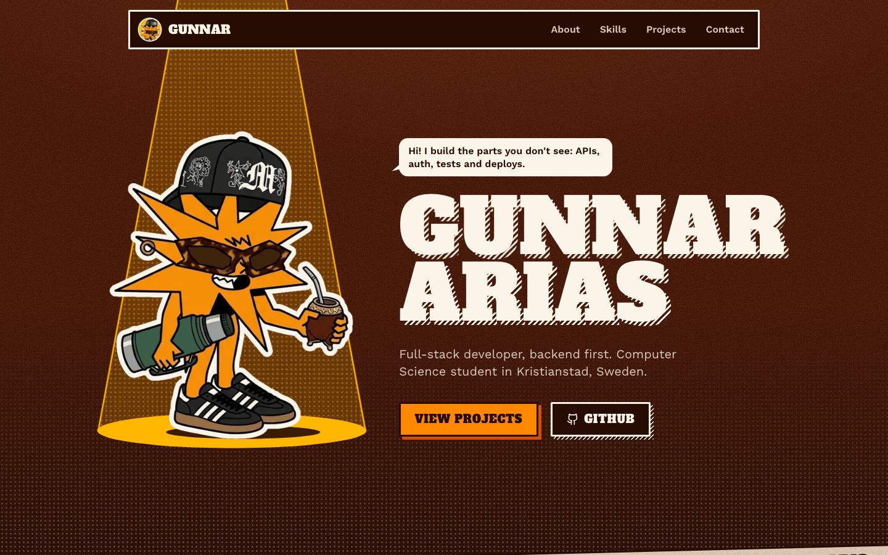

# gunnarwrld.com — Personal Portfolio

> The source for [**gunnarwrld.com**](https://gunnarwrld.com) — a single-page React + TypeScript portfolio in a woodcut / comic style, with a star mascot, project cards fed by a GitHub sync, and a working contact form backed by a Vercel serverless function.

<p align="center">
  <a href="https://gunnarwrld.com">
    
  </a>
</p>

<p align="center">
  <a href="https://gunnarwrld.com"></a>
  <a href="https://github.com/gunnarwrld/PersonalPortfolio/actions/workflows/ci.yml"></a>
  
  
  
  
  
</p>

---

## Highlights

- 🪵 **A small woodcut design system** — ten colours with one job each, three self-hosted typefaces (Alfa Slab One, Work Sans, Courier Prime), ivory ink lines and hatched hard shadows. Details in [Design system](#design-system).
- ⭐ **A mascot that answers** — the star pops in under a spotlight, waves when you point at it, and jumps with confetti when a message is sent. The moves are plain CSS keyframes, and all of it stops for visitors who prefer reduced motion.
- 🔄 **Project facts from GitHub** — each card shows languages, last push and live link from a daily sync that opens a review pull request.
- 📨 **Real contact form** — React Hook Form + Zod on the client, validated again on a Vercel serverless function that sends mail through [Resend](https://resend.com), with a honeypot and per-IP rate limiting.
- ⚡ **Vite + SWC + TypeScript** — fast dev loop, ESLint flat config, no animation library in the bundle.
- 🧪 **Tested with Vitest + Testing Library + Playwright** — unit tests (including tests that keep the project copy honest), end-to-end tests on desktop and phone sizes, and an [axe](https://github.com/dequelabs/axe-core) accessibility scan.
- ♿ **Accessible by default** — semantic landmarks, labelled controls, a focus ring that shows on dark and on paper, measured colour contrast.

## Tech stack

| Layer | Choice |
|---|---|
| Framework | React 18 + TypeScript 5 |
| Build | Vite 5 (`@vitejs/plugin-react-swc`) |
| Styling | Tailwind CSS 3 + `tailwindcss-animate` + custom design tokens |
| UI primitives | [shadcn/ui](https://ui.shadcn.com) on top of Radix |
| Motion | CSS keyframes and transitions (no animation library) |
| Forms & validation | React Hook Form + Zod |
| API | Vercel Serverless Functions (Node 20) |
| Email | [Resend](https://resend.com) |
| Hosting | Vercel |
| Testing | Vitest, @testing-library/react, Playwright, axe-core |

## Project structure

```
.
├── .github/workflows/
│   ├── ci.yml                    # Lint, types, Vitest, build, Playwright
│   ├── sync-github-projects.yml  # Refresh facts and open a review PR
│   └── portfolio-dispatch.yml    # Reusable notifier other repos call
├── api/
│   ├── contact.ts          # Vercel serverless route — validates + sends email via Resend
│   └── og.tsx              # Edge OG image for /api/og (social cards)
├── e2e/
│   └── smoke.spec.ts       # Playwright smoke tests
├── public/
│   ├── fonts/              # Self-hosted typefaces (woff2, plus woff for the OG image)
│   ├── mascot/             # The star: hero sticker, logo badge, OG image art
│   └── 404.html            # Static not-found page, served by the host with a real 404
├── scripts/
│   ├── sync-github.ts      # Reads the public GitHub API and writes github-sync.json
│   └── mascot/             # How the mascot files and its moves were generated
├── src/
│   ├── components/         # Hero, About, Skills, Projects, Contact, Navbar, Mascot, …
│   ├── data/
│   │   ├── projects.ts      # Hand-written cards. Set `repo` to link a GitHub project.
│   │   ├── watchedRepos.ts  # Repos the daily sync refreshes
│   │   ├── github-sync.json # Generated GitHub facts. Do not edit by hand.
│   │   ├── skills.ts        # Edit me to update the skill matrix
│   │   └── site.ts          # Name, email, social links and section names, in one place
│   ├── hooks/              # Reusable hooks (use-scroll-spy, use-toast)
│   ├── lib/                # Utilities (cn helper, github sync, language shares)
│   ├── pages/              # Index + 404
│   ├── styles/             # Generated CSS (the mascot's moves)
│   ├── test/               # Vitest setup + unit tests
│   ├── index.css           # Design tokens, components and motion
│   ├── App.tsx             # Routes
│   └── main.tsx            # App entry
├── templates/
│   └── notify-portfolio.yml # Copy into another repo's .github/workflows/
├── tailwind.config.ts
├── vite.config.ts
└── playwright.config.ts
```

## Quick start

```bash
git clone https://github.com/gunnarwrld/PersonalPortfolio.git
cd PersonalPortfolio
npm install
cp .env.example .env.local
npm run dev            # http://localhost:8080
```

For local API testing the easiest path is the Vercel CLI, which runs the SPA and the `/api/*` functions side by side:

```bash
npm i -g vercel
vercel dev             # http://localhost:3000
```

## Environment variables

| Variable | Required | Description |
|---|---|---|
| `RESEND_API_KEY` | ✅ | Server-side API key from [Resend](https://resend.com/api-keys). |
| `CONTACT_TO` | ✅ | Address that receives form submissions, e.g. `ariasgunnar@gmail.com`. |
| `CONTACT_FROM` | optional | Verified sender. Defaults to `Portfolio <onboarding@resend.dev>`. In production, verify a domain on Resend and use, e.g., `Gunnar <contact@gunnarwrld.com>`. |

In Vercel, add these under **Project → Settings → Environment Variables** for the **Production** and **Preview** environments. Locally, copy `.env.example` to `.env.local`.

## Scripts

| Command | What it does |
|---|---|
| `npm run dev` | Vite dev server with HMR. |
| `npm run build` | Production build with Vite (no type-check; CI type-checks in a separate job). |
| `npm run typecheck` | TypeScript check of the app and the `api/` functions. |
| `npm run preview` | Serve the production build locally. |
| `npm run lint` | ESLint over the whole project. |
| `npm test` | Vitest in CI mode. |
| `npm run test:watch` | Vitest in watch mode. |
| `npm run sync:github` | Refresh `src/data/github-sync.json` from the public GitHub API. |

## Design system

The look is a vintage woodcut / comic print: a dark stage drawn in ivory ink, paper for the things you could pick up, and orange for the mascot.

**Colours.** Ten tokens in [`src/index.css`](src/index.css), mapped to Tailwind in [`tailwind.config.ts`](tailwind.config.ts). Each has one job, and the jobs follow from measured WCAG contrast:

| Token | Hex | Job |
|---|---|---|
| mahogany | `#441505` | Page background |
| espresso | `#260B02` | Deep panels; text on paper |
| russet | `#5E230D` | Warm glow at the top of the page; hover fill on dark |
| ivory | `#FAF5E8` | Every line and border; main text on dark (14.2:1 on mahogany) |
| parchment | `#DECBB8` | Paper surfaces; second-level text on dark (9.8:1) |
| stone | `#C8C3B7` | Third-level text on dark only (it disappears on parchment) |
| cocoa | `#8C6B56` | Dots, hatching and grain. Never text: at most 4.4:1 on any surface |
| tangerine | `#FF8800` | The mascot and the one primary button per view (espresso label, 7.8:1) |
| amber | `#FFB700` | The spotlight; primary button hover |
| rust | `#D44D00` | Primary button shadow and error borders. Never small text |

The three browns are too close to separate surfaces (1.2 to 1.5:1 between them), so every edge is an ivory line. The focus ring is two-tone, ivory and espresso, so it shows on the dark stage and on paper.

**Type.** Alfa Slab One for the name, section names and buttons; Work Sans for reading; Courier Prime for anything that came from a repository (dates, language shares, statuses). All three are open-licensed and served from [`public/fonts`](public/fonts).

**Motion.** One choreographed moment, the hero entrance. Everything else answers the visitor: panels print in as they scroll into view, buttons press down like a stamp, the star reacts to the contact form. `prefers-reduced-motion` turns all of it off, and content never depends on an animation to become visible.

**Mascot.** The star is the logo and the focal art. [`scripts/mascot/README.md`](scripts/mascot/README.md) explains how its files and its moves are generated.

## Contact form architecture

```
Browser ──POST /api/contact──► Vercel func ──► api/contact.ts (Node 20)
                                                  │
                                                  ├── Zod parse + length caps
                                                  ├── Per-IP rate limit (5/min)
                                                  ├── Honeypot check
                                                  └── resend.emails.send → Resend ──► your inbox
```

- Validation runs **twice**: once on the client (`zodResolver` in React Hook Form) for instant UX, once on the server so the route can't be bypassed by curl.
- All user-supplied strings are HTML-escaped before being interpolated into the outgoing email.
- The honeypot field (`website`) is rendered far off-screen with `aria-hidden` and `tabIndex={-1}`. Real users never touch it; bots almost always fill it, and we silently 200 those submissions.

## Deployment

The site auto-deploys from `main` to Vercel. Pushing to a feature branch creates a preview deploy with its own URL. Production domain is `gunnarwrld.com`.

To deploy your own fork:

1. [Import the repo into Vercel](https://vercel.com/new) — framework auto-detected as **Vite**, no overrides needed.
2. Add the three environment variables above.
3. Push to `main`.

## Syncing project facts from GitHub

Pushes to the default branch of a project repo open a pull request here that refreshes GitHub-derived facts. Nothing in this flow pushes to `main`. You merge the PR when the diff looks right.

The sync reads each watched repo from the public API and writes `src/data/github-sync.json`:

- description, topics, and language breakdown
- homepage, default branch, last push, archived flag, and stars

Cards that set `repo` in [`src/data/projects.ts`](src/data/projects.ts) use that file for languages, last push, the live link, the repo link, and the archived flag. Blurbs, feature lists, screenshots, and the order of the cards stay in `projects.ts`. A watched repo with no `repo` field does not get a card. The pull request lists it under **Not on the site yet**.

Watched repos live in [`src/data/watchedRepos.ts`](src/data/watchedRepos.ts). The daily run refreshes that list only. A `repository_dispatch` for one repo updates that repo in the file. The next daily run drops a repo that is not on the list, so add a keeper to `WATCHED_REPOS`.

`repository_dispatch` only starts workflows that are already on the default branch. Merge this setup before you expect notifiers to do anything.

### Workflows

| File | When it runs |
|---|---|
| [`.github/workflows/sync-github-projects.yml`](.github/workflows/sync-github-projects.yml) | `repository_dispatch` type `project-updated`, **Actions → Sync GitHub project facts → Run workflow**, and a daily sweep at 06:17 UTC. |
| [`.github/workflows/portfolio-dispatch.yml`](.github/workflows/portfolio-dispatch.yml) | Called by other repos. Posts the dispatch event. |
| [`templates/notify-portfolio.yml`](templates/notify-portfolio.yml) | The file you copy into a project repo. |

If the generated file matches `main`, the sync workflow stops and does not open a pull request. When something changed, it force-pushes the rolling branch `github-sync` (rebuilt from `main` each run) and opens or updates one PR.

### Token

Create one fine-grained personal access token:

1. GitHub → **Settings → Developer settings → Personal access tokens → Fine-grained tokens → Generate new token**.
2. Resource owner: **gunnarwrld**. Repository access: **Only select repositories → PersonalPortfolio**.
3. Permissions:
   - **Contents: Read and write.** This is the minimum `repository_dispatch` needs. GitHub lists `POST /repos/{owner}/{repo}/dispatches` under Contents write, with no extra permission beside it. **Metadata: Read-only** is selected automatically.
   - **Pull requests: Read and write.** The dispatch call does not need this. Add it so the same token, stored on PersonalPortfolio, can open the review PR. A pull request opened that way runs lint, tests, Playwright, and the Vercel preview. The default `GITHUB_TOKEN` does not start those workflows.
4. Copy the token once. It is a secret. Do not commit it and do not paste it into a workflow file.

Classic tokens can dispatch to a public repository with the **`public_repo`** scope. Prefer the fine-grained token above.

Add the token as an Actions secret named **`PORTFOLIO_DISPATCH_TOKEN`**:

| Repository | Settings → Secrets and variables → Actions | Why |
|---|---|---|
| Each project repo that should notify the site | `PORTFOLIO_DISPATCH_TOKEN` | Sends `project-updated` to this repo. Contents write on PersonalPortfolio is enough here. |
| **PersonalPortfolio** | `PORTFOLIO_DISPATCH_TOKEN` | Pushes `github-sync` and opens the PR as you, so CI runs. Needs Contents write and Pull requests write. |

The sync job reads other repos without this token. Their metadata is public. A token limited to PersonalPortfolio cannot see those repos, so the workflow does not use it for the API read.

### Repository setting

You do **not** have to change Actions permissions if `PORTFOLIO_DISPATCH_TOKEN` is set on PersonalPortfolio.

If that secret is missing, the workflow falls back to `GITHUB_TOKEN`. That path needs:

**PersonalPortfolio → Settings → Actions → General → Workflow permissions → Allow GitHub Actions to create and approve pull requests.**

Leave it off unless you are using the fallback. Pull requests opened with `GITHUB_TOKEN` do not start the workflows in this repo (lint, Vitest, Playwright). Vercel can still build a preview, because that check comes from the Vercel GitHub App.

Do not grant Actions write access to `main`. This workflow never pushes the default branch.

### Notifier for a project repo

Actions has to be enabled on that repo (the default). Copy [`templates/notify-portfolio.yml`](templates/notify-portfolio.yml) to `.github/workflows/notify-portfolio.yml`:

```yaml
name: Notify portfolio

on:
  push:

permissions: {}

jobs:
  dispatch:
    if: github.ref == format('refs/heads/{0}', github.event.repository.default_branch)
    uses: gunnarwrld/PersonalPortfolio/.github/workflows/portfolio-dispatch.yml@main
    secrets:
      PORTFOLIO_DISPATCH_TOKEN: ${{ secrets.PORTFOLIO_DISPATCH_TOKEN }}
```

The `if` limits the job to the repo's default branch, including repos whose default branch is not `main`. Pushes to other branches start the workflow and skip the job.

Then add `PORTFOLIO_DISPATCH_TOKEN` on that repo. To show the project on the site, add a card in `src/data/projects.ts` with `repo` set to `gunnarwrld/<name>`, and add the name to `WATCHED_REPOS` if it is not already there. The sync will not create the card for you.

Run the refresh locally with `npm run sync:github`. `npm run sync:github -- --repo ledger-api` refreshes one repo. Unauthenticated requests are enough for public repos; the script uses `GITHUB_TOKEN` only when it is already set.

## Roadmap

- [x] Dynamic `og:image` via [`api/og.tsx`](api/og.tsx) — the homepage meta tags already point at `/api/og` (1200×630, edge runtime)
- [ ] Per-project case-study pages with screenshots, decisions, and trade-offs
- [ ] `/blog` route with MDX
- [ ] Lighthouse CI in GitHub Actions

## License

MIT © Gunnar Arias — see [LICENSE](./LICENSE).

---

<sub>Built in Sweden 🇸🇪, fuelled by mate. Reach me at [ariasgunnar@gmail.com](mailto:ariasgunnar@gmail.com) · [LinkedIn](https://linkedin.com/in/gunnararias) · [GitHub](https://github.com/gunnarwrld).</sub>
