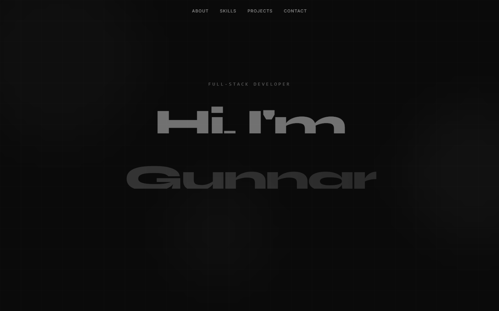

# gunnarwrld.com — Personal Portfolio

> The source for [**gunnarwrld.com**](https://gunnarwrld.com) — a single-page React + TypeScript portfolio with motion design, glass UI, and a working contact form backed by a Vercel serverless function.

<p align="center">
  <a href="https://gunnarwrld.com">
    
  </a>
</p>

<p align="center">
  <a href="https://gunnarwrld.com"></a>
  <a href="https://github.com/gunnarwrld/PersonalPortfolio/actions/workflows/ci.yml"></a>
  
  
  
  
  
</p>

---

## Highlights

- 🎬 **Motion-first hero** — scroll-linked Framer Motion with parallax, springs, and 3D card reveals.
- 🪟 **Glass UI on a dark grid** — Syne / Inter / JetBrains Mono type stack with a numbered section rhythm (`01 — About`, `02 — Skills`, …).
- 📨 **Real contact form** — React Hook Form + Zod on the client, validated again on a Vercel serverless function that sends mail through [Resend](https://resend.com), with a honeypot and per-IP rate limiting.
- ⚡ **Vite + SWC + TypeScript** — fast dev loop, strict types, ESLint flat config.
- 🧪 **Tested with Vitest + Testing Library + Playwright** for unit and end-to-end coverage.
- ♿ **Accessible by default** — semantic landmarks, labelled controls, focus-visible affordances.

## Tech stack

| Layer | Choice |
|---|---|
| Framework | React 18 + TypeScript 5 |
| Build | Vite 5 (`@vitejs/plugin-react-swc`) |
| Styling | Tailwind CSS 3 + `tailwindcss-animate` + custom design tokens |
| UI primitives | [shadcn/ui](https://ui.shadcn.com) on top of Radix |
| Motion | Framer Motion 12 |
| Forms & validation | React Hook Form + Zod |
| API | Vercel Serverless Functions (Node 20) |
| Email | [Resend](https://resend.com) |
| Hosting | Vercel |
| Testing | Vitest, @testing-library/react, Playwright |

## Project structure

```
.
├── api/
│   └── contact.ts          # Vercel serverless route — validates + sends email via Resend
├── public/                 # Static assets served at the site root
├── src/
│   ├── components/         # Hero, About, Skills, Projects, Contact, Navbar, …
│   ├── data/
│   │   ├── projects.ts     # Edit me to add/update projects
│   │   └── skills.ts       # Edit me to update the skill matrix
│   ├── hooks/              # Reusable hooks (use-mobile, use-toast)
│   ├── lib/                # Utilities (cn helper, etc.)
│   ├── pages/              # Index + 404
│   ├── test/               # Vitest setup + unit tests
│   ├── App.tsx             # Routes
│   └── main.tsx            # App entry
├── tailwind.config.ts
├── vite.config.ts
└── playwright.config.ts
```

## Quick start

```bash
git clone https://github.com/gunnarwrld/PersonalPortfolio.git
cd PersonalPortfolio
npm install            # or: bun install
cp .env.example .env.local
npm run dev            # http://localhost:8080
```

For local API testing the easiest path is the Vercel CLI, which runs the SPA and the `/api/*` functions side by side:

```bash
npm i -g vercel
vercel dev             # http://localhost:3000
```

## Environment variables

| Variable | Required | Description |
|---|---|---|
| `RESEND_API_KEY` | ✅ | Server-side API key from [Resend](https://resend.com/api-keys). |
| `CONTACT_TO` | ✅ | Address that receives form submissions, e.g. `ariasgunnar@gmail.com`. |
| `CONTACT_FROM` | optional | Verified sender. Defaults to `Portfolio <onboarding@resend.dev>`. In production, verify a domain on Resend and use, e.g., `Gunnar <contact@gunnarwrld.com>`. |

In Vercel, add these under **Project → Settings → Environment Variables** for the **Production** and **Preview** environments. Locally, copy `.env.example` to `.env.local`.

## Scripts

| Command | What it does |
|---|---|
| `npm run dev` | Vite dev server with HMR. |
| `npm run build` | Type-checked production build. |
| `npm run preview` | Serve the production build locally. |
| `npm run lint` | ESLint over the whole project. |
| `npm test` | Vitest in CI mode. |
| `npm run test:watch` | Vitest in watch mode. |

## Contact form architecture

```
Browser ──POST /api/contact──► Vercel Edge ──► api/contact.ts (Node 20)
                                                  │
                                                  ├── Zod parse + length caps
                                                  ├── Per-IP rate limit (5/min)
                                                  ├── Honeypot check
                                                  └── resend.emails.send → Resend ──► your inbox
```

- Validation runs **twice**: once on the client (`zodResolver` in React Hook Form) for instant UX, once on the server so the route can't be bypassed by curl.
- All user-supplied strings are HTML-escaped before being interpolated into the outgoing email.
- The honeypot field (`website`) is rendered far off-screen with `aria-hidden` and `tabIndex={-1}`. Real users never touch it; bots almost always fill it, and we silently 200 those submissions.

## Deployment

The site auto-deploys from `main` to Vercel. Pushing to a feature branch creates a preview deploy with its own URL. Production domain is `gunnarwrld.com`.

To deploy your own fork:

1. [Import the repo into Vercel](https://vercel.com/new) — framework auto-detected as **Vite**, no overrides needed.
2. Add the three environment variables above.
3. Push to `main`.

## Roadmap

- [ ] Server-side render or prerender so social cards include a real `og:image`
- [ ] Per-project case-study pages with screenshots, decisions, and trade-offs
- [ ] `/blog` route with MDX
- [ ] Lighthouse CI in GitHub Actions

## License

MIT © Gunnar Arias — see [LICENSE](./LICENSE).

---

<sub>Built in Sweden 🇸🇪 with too much coffee. Reach me at [ariasgunnar@gmail.com](mailto:ariasgunnar@gmail.com) · [LinkedIn](https://linkedin.com/in/gunnararias) · [GitHub](https://github.com/gunnarwrld).</sub>
